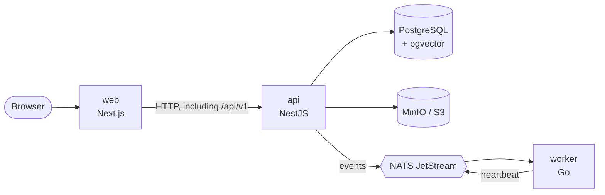

🇪🇸 [Leer esta documentación en español](README.md)

# VeraRAG

[](https://github.com/ricardoverita/verarag/actions/workflows/ci.yml)

VeraRAG is an open-source enterprise knowledge and retrieval platform built for secure, explainable and observable RAG systems.

> **Status:** VeraRAG is at an early stage. The base architecture, accounts, organizations, API keys, collections and document uploads work, but it is not a production RAG platform yet. Documents are stored today but not processed: there is no ingestion, search or chat.

## What VeraRAG is

VeraRAG is not meant to be "a chatbot for PDFs". It is a platform an organization can use to build its own private knowledge base: connect internal documents and sources, search them and ask questions about them, knowing where each answer comes from and who can see what.

The path a question will take:

```
Sources → Documents → Ingestion → Chunking → Embeddings → Retrieval
        → Reranking / Evidence → LLM → Answer + sources
```

None of these stages exist yet. Each one has its own phase in the [roadmap](#roadmap).

## The problem

Much of a company's knowledge is spread across documents, wikis, repositories and shared folders. Putting an LLM on top is easy; doing it well is not:

- **Permissions.** An answer must not use documents the person asking is not allowed to read.
- **Isolation.** One organization's data must never mix with another's.
- **Traceability.** Every answer has to be backed by its sources, and the system has to be able to say "I don't know" when the evidence is not enough.
- **Observability and evaluation.** You need to measure what gets retrieved, how long it takes, what it costs and whether answers are faithful to the sources.
- **Control.** Many organizations need to run it on their own infrastructure and choose their own LLM and embedding providers.

VeraRAG tries to address these concerns by design, not as patches added later.

## Current status

Phase 0 provided a runnable foundation, phase 1 added organizations and access, and phase 2 documents:

- **Accounts and sessions.** Sign-up and sign-in with email and password (Argon2id), revocable sessions in an `HttpOnly` cookie, and protection against CSRF, session fixation and brute force.
- **Organizations.** A person can belong to several, with OWNER, ADMIN, MEMBER and VIEWER roles. An organization never loses its last owner, and nobody sees data from an organization they do not belong to.
- Single-use **invitations** by link, and organization **API keys** with scopes.
- **Collections and documents.** PDF, DOCX, Markdown, plain text and HTML stream all the way to S3 storage, with the size limit enforced as the file arrives, SHA-256 computed on the fly and the type checked by extension and content. They are always downloaded as files, never shown in the browser, and deleted without losing traceability.
- **API** in NestJS with common validation and error format, OpenAPI documentation in development, an audit trail, health, readiness, metrics, a detailed system status and a development endpoint that publishes a test event.
- **Worker** in Go that consumes that event from NATS JetStream, validates it against its contract and writes a structured log line. It publishes a heartbeat so the API knows it is alive.
- **Web app** in Next.js with sign-up, sign-in, a dashboard, an organization switcher, collections and documents (uploads with real progress), and settings for the organization, members, invitations and API keys.
- **Contracts** in JSON Schema shared by TypeScript and Go.
- **PostgreSQL with pgvector**, **NATS JetStream**, **MinIO** and **Redis** in Docker Compose.
- Structured logs, request ids, Prometheus metrics and optional distributed tracing.
- CI with lint, typecheck, unit tests and integration tests against a real PostgreSQL and MinIO, builds, Docker images and an end-to-end smoke test.

What does **not** exist yet: text extraction and ingestion, embeddings, search, RAG, connectors, antivirus, SSO, email verification or password reset. Redis is provisioned, but no service uses it yet.

## Architecture



- The browser only talks to the **web app**, which passes `/api/v1` on to the API from its server. The session cookie belongs to the web app's origin and there is no CORS.
- The **API** is the control plane: it owns accounts, sessions, organizations and their permissions, and it will own metadata and query orchestration.
- The **worker** is the data plane: it will process documents, chunks and embeddings.
- The API and the worker never call each other directly. They communicate through NATS JetStream using payloads defined in `packages/contracts`.
- **PostgreSQL** is the source of truth and will store vectors next to their metadata, so permissions are applied in the same query.

More detail in [docs/architecture](docs/architecture/overview.md), in [authentication and organizations](docs/architecture/auth-and-tenancy.md) and in the [ADRs](docs/adr/README.md). The environment variables of each service are listed in [docs/configuration.md](docs/configuration.md). The technical documentation is in Spanish for now.

## Stack

| Piece               | Technology                                                    |
| ------------------- | ------------------------------------------------------------- |
| Web                 | Next.js 16, React 19, TypeScript                              |
| API / control plane | NestJS 12, Node.js 24, TypeScript                             |
| Worker / data plane | Go 1.27                                                       |
| Messaging           | NATS 2.15 with JetStream                                      |
| Database            | PostgreSQL 18 + pgvector 0.8.7                                |
| Migrations          | dbmate (plain SQL)                                            |
| Authentication      | Argon2id, opaque sessions in PostgreSQL                       |
| API documentation   | OpenAPI 3 generated from the Zod schemas                      |
| Storage             | S3 API with streaming multipart uploads; MinIO in development |
| Cache (future)      | Redis 8                                                       |
| Contracts           | JSON Schema 2020-12                                           |
| Observability       | pino, slog, Prometheus, Grafana, OpenTelemetry, Jaeger        |
| Tests               | Vitest, Supertest, Testcontainers, `go test`                  |
| Monorepo            | pnpm workspaces + Go modules                                  |

## Quick start

You need Docker with Compose v2. Once running, the containers use about 300 MB of memory; the first build needs quite a bit more, mostly for the web app.

```bash
git clone https://github.com/ricardoverita/verarag.git
cd verarag
cp .env.example .env
docker compose up --build
```

The first build takes a few minutes. Once everything is up:

| Service           | URL                                |
| ----------------- | ---------------------------------- |
| Web               | http://localhost:3000              |
| API documentation | http://localhost:3001/api/docs     |
| API readiness     | http://localhost:3001/health/ready |
| MinIO console     | http://localhost:9001              |
| NATS monitoring   | http://localhost:8222              |

### First steps

1. Open http://localhost:3000 and click **Create an account**. It also creates your first organization, where you are the owner.
2. The dashboard shows the organization and the status of each component: API, Database, Messaging, Worker and Object storage should all be _Healthy_.
3. In **Members**, invite someone: you get a link that is shown only once. Open it in another private window to create the second account.
4. In **Collections**, create a collection and upload a document by dropping or picking it. Its page shows the type, size, SHA-256 and uploader, and lets you download and delete it.
5. In **API keys**, create a key and try it:

```bash
curl -H "Authorization: Bearer $VERARAG_API_KEY" http://localhost:3000/api/v1/system/status
```

With the `documents:read` or `documents:write` scopes, the same key reads or uploads documents ([details](docs/architecture/documents.md), in Spanish).

If you open the web app at another address, such as `http://127.0.0.1:3000`, set `WEB_PUBLIC_URL` in `.env` so invitation links point to it.

### Try the event flow

```bash
curl -X POST http://localhost:3001/api/v1/dev/events \
  -H 'Content-Type: application/json' \
  -d '{"type": "system.test", "message": "hello from VeraRAG"}'

docker compose logs worker
```

The API publishes the event to NATS JetStream and the worker consumes it and writes a line like this one:

```json
{
  "level": "info",
  "msg": "system test event received",
  "event_id": "…",
  "correlation_id": "…",
  "message": "hello from VeraRAG"
}
```

`./scripts/smoke-test.sh` runs all of these checks at once.

The `/api/v1/dev/events` endpoint is for development only: it exists because `.env.example` sets `DEV_ENDPOINTS_ENABLED=true`.

### Observability

```bash
docker compose --profile observability up --build
```

This adds Prometheus (http://localhost:9090), Grafana (http://localhost:3002, user `admin`) and Jaeger (http://localhost:16686). To see traces, set `OTEL_EXPORTER_OTLP_ENDPOINT=http://jaeger:4318` in `.env`. Details in [docs/architecture/observability.md](docs/architecture/observability.md).

### If a port is already taken

Every port is published only on `127.0.0.1` and can be changed in `.env` (`WEB_PORT`, `API_PORT`, `POSTGRES_PORT`, etc.).

## Development commands

```bash
pnpm install          # dependencies; also builds packages/contracts
pnpm lint             # ESLint
pnpm format           # Prettier
pnpm typecheck        # TypeScript in every package
pnpm test             # contracts, api and web tests; integration tests need Docker
pnpm build            # builds contracts, api and web

cd apps/worker && go vet ./... && go test -race ./...
cd packages/contracts && go test ./...

./scripts/smoke-test.sh   # end-to-end against the Docker environment
```

To work with hot reload (infrastructure in Docker and the app on your machine), see [CONTRIBUTING.en.md](CONTRIBUTING.en.md).

## Repository layout

```
apps/
  api/            API and control plane (NestJS); migrations in db/migrations
  web/            user interface (Next.js)
  worker/         data plane (Go)
packages/
  contracts/      shared JSON Schemas, with types and validators for TS and Go
deployments/
  docker/         Prometheus and Grafana configuration
docs/
  adr/            architecture decisions
  architecture/   overview, API, authentication, documents, messaging and observability
  configuration.md
  roadmap.md
scripts/
  smoke-test.sh   end-to-end test of the local environment
compose.yaml      local environment with Docker Compose
```

## Roadmap

| Phase | Scope                                                                                                                            |
| ----- | -------------------------------------------------------------------------------------------------------------------------------- |
| 0     | **Foundation**: monorepo, Docker, API, web, worker, NATS, PostgreSQL, pgvector, Redis, MinIO, base observability and CI. _Done._ |
| 1     | **Organizations, users and authentication**: accounts, sessions, roles, invitations, API keys and tenant isolation. _Done._      |
| 2     | **Documents and storage**: collections, streaming uploads and downloads, checksums, recoverable states. _Done._                  |
| 3     | Ingestion pipeline. _Next._                                                                                                      |
| 4     | Chunking and embeddings                                                                                                          |
| 5     | Vector retrieval and first RAG                                                                                                   |
| 6     | Citations and conversations                                                                                                      |
| 7     | Hybrid retrieval: vector search, lexical search and RRF                                                                          |
| 8     | Reranking and JEV: evidence classification, reranking and evidence gating                                                        |
| 9     | Enterprise permissions: RBAC, collections, document permissions and tenant isolation                                             |
| 10    | RAG evaluation: datasets, retrieval metrics, faithfulness, latency, token usage and cost                                         |
| 11    | Connectors: GitHub, Google Drive, S3, websites and more                                                                          |
| 12    | Production hardening and self-hosting                                                                                            |

The details of each phase, including what makes it done, are in [docs/roadmap.md](docs/roadmap.md) (in Spanish).

## Security

- If you find a vulnerability, **do not open a public issue**: follow [SECURITY.en.md](SECURITY.en.md).
- Routes require a session or an API key, except the public ones (sign-up, sign-in, invitations and health). Uploaded documents are treated as untrusted content: the bucket is private, object keys contain no file names, and downloads are always attachments with `nosniff` and a sandbox CSP. Passwords are stored with Argon2id, and tokens and keys only as hashes. The current state and known limitations are in [SECURITY.en.md](SECURITY.en.md#current-state).
- Compose only publishes ports on `127.0.0.1`. Do not expose this environment to the internet without a TLS proxy in front and `APP_ENV=production`.
- The values in `.env.example` and the `compose.yaml` setup are for local development: example credentials, NATS without authentication and the development endpoint enabled.
- `.env` is in `.gitignore`. Do not commit real secrets.
- The API and the worker validate their configuration on startup and stop with a clear message when something is missing.
- The API sets security headers and limits JSON body size and request rates, with stricter limits on sign-in, sign-up and invitations. The API, web and worker images run as non-root users.
- CI runs `pnpm audit` on production dependencies and `govulncheck` on the Go code, and Dependabot proposes updates weekly.

## Contributing

Contributions are welcome. Read [CONTRIBUTING.en.md](CONTRIBUTING.en.md) to set up the environment, learn the code style and see how to propose changes. This project follows a [code of conduct](CODE_OF_CONDUCT.en.md).

## License

VeraRAG is distributed under the [Apache License 2.0](LICENSE).

In short, it allows commercial use, modification, distribution and private use, and it includes an explicit patent grant from contributors. In return, you must keep the copyright and license notices (including the [NOTICE](NOTICE) file) and state the changes you made to modified files. It grants no trademark rights and comes without warranty.

This summary does not replace the license text.

## Author

VeraRAG was started by **Ricardo Vera**, Software Engineer / Solutions Architect.

- GitHub: [https://github.com/ricardoverita](https://github.com/ricardoverita)
- Web: [https://www.ricardovera.dev](https://www.ricardovera.dev)
