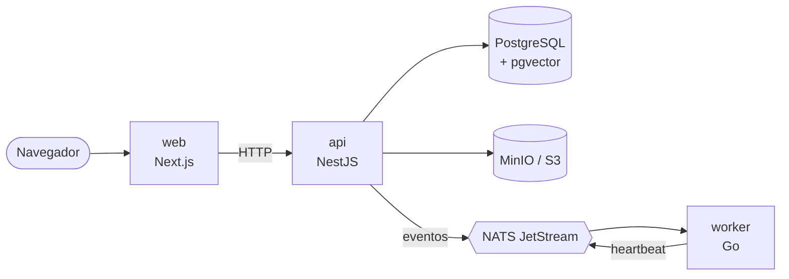

🇬🇧 [Read this documentation in English](README.en.md)

# VeraRAG

[](https://github.com/ricardoverita/verarag/actions/workflows/ci.yml)

VeraRAG es una plataforma open source de conocimiento y recuperación empresarial diseñada para construir sistemas RAG seguros, explicables y observables.

> **Estado:** VeraRAG está en una etapa inicial. La arquitectura base funciona, pero todavía no es una plataforma RAG de producción. Hoy no hay ingesta de documentos, búsqueda ni chat.

## Qué es VeraRAG

VeraRAG no pretende ser "un chatbot para PDFs". Es una plataforma sobre la que una organización puede construir su propia base de conocimiento privada: conectar documentos y fuentes internas, buscar en ellos y hacer preguntas, sabiendo de dónde sale cada respuesta y quién puede ver qué.

El recorrido que seguirá una pregunta:

```
Fuentes → Documentos → Ingesta → Chunking → Embeddings → Recuperación
        → Reranking / Evidencia → LLM → Respuesta + fuentes
```

Ninguna de esas etapas existe todavía. Cada una tiene su fase en el [roadmap](#roadmap).

## El problema

Buena parte del conocimiento de una empresa vive repartido en documentos, wikis, repositorios y carpetas compartidas. Añadirle un LLM encima es fácil; hacerlo bien no tanto:

- **Permisos.** Una respuesta no puede usar documentos que la persona que pregunta no tiene permiso para leer.
- **Aislamiento.** Los datos de una organización no pueden mezclarse con los de otra.
- **Trazabilidad.** Cada respuesta tiene que poder justificarse con sus fuentes, y saber decir "no lo sé" cuando la evidencia no alcanza.
- **Observabilidad y evaluación.** Hace falta medir qué se recupera, cuánto tarda, cuánto cuesta y si las respuestas son fieles a las fuentes.
- **Control.** Muchas organizaciones necesitan ejecutarlo en su propia infraestructura y elegir sus proveedores de LLM y de embeddings.

VeraRAG intenta resolver esas cosas desde el diseño, no como parches posteriores.

## Estado actual

Esta primera iteración (fase 0) deja una base ejecutable:

- **API** en NestJS con health, readiness, métricas, estado detallado del sistema y un endpoint de desarrollo que publica un evento de prueba.
- **Worker** en Go que consume ese evento desde NATS JetStream, lo valida contra su contrato y lo registra en un log estructurado. Publica un heartbeat para que la API sepa que está vivo.
- **Web** en Next.js que explica el proyecto y muestra el estado de cada componente.
- **Contratos** en JSON Schema compartidos por TypeScript y Go.
- **PostgreSQL con pgvector**, **NATS JetStream**, **MinIO** y **Redis** en Docker Compose.
- Logs estructurados, request ids, métricas de Prometheus y trazas distribuidas opcionales.
- CI con lint, typecheck, tests, builds, imágenes de Docker y un test end-to-end.

Lo que **no** existe todavía: autenticación, organizaciones, documentos, ingesta, embeddings, búsqueda, RAG ni conectores. Redis está provisionado, pero ningún servicio lo usa aún.

## Arquitectura



- La **web** solo habla con la API, y lo hace desde su servidor.
- La **API** es el control plane: será dueña de la autenticación, los permisos, los metadatos y la orquestación de las consultas.
- El **worker** es el data plane: procesará documentos, fragmentos y embeddings.
- La API y el worker nunca se llaman directamente. Se comunican por NATS JetStream con payloads definidos en `packages/contracts`.
- **PostgreSQL** es la fuente de verdad y guardará los vectores junto a sus metadatos, para que los permisos se apliquen en la misma consulta.

Más detalle en [docs/architecture](docs/architecture/overview.md) y en los [ADR](docs/adr/README.md). Las variables de entorno de cada servicio están en [docs/configuration.md](docs/configuration.md).

## Stack

| Pieza               | Tecnología                                             |
| ------------------- | ------------------------------------------------------ |
| Web                 | Next.js 16, React 19, TypeScript                       |
| API / control plane | NestJS 12, Node.js 24, TypeScript                      |
| Worker / data plane | Go 1.27                                                |
| Mensajería          | NATS 2.15 con JetStream                                |
| Base de datos       | PostgreSQL 18 + pgvector 0.8.7                         |
| Migraciones         | dbmate (SQL plano)                                     |
| Almacenamiento      | API de S3; MinIO en desarrollo                         |
| Caché (futuro)      | Redis 8                                                |
| Contratos           | JSON Schema 2020-12                                    |
| Observabilidad      | pino, slog, Prometheus, Grafana, OpenTelemetry, Jaeger |
| Tests               | Vitest, Supertest, `go test`                           |
| Monorepo            | pnpm workspaces + módulos de Go                        |

## Quick start

Necesitas Docker con Compose v2. Con todo en marcha, los contenedores usan unos 300 MB de memoria; la primera build necesita bastante más, sobre todo la de la web.

```bash
git clone https://github.com/ricardoverita/verarag.git
cd verarag
cp .env.example .env
docker compose up --build
```

La primera build tarda unos minutos. Cuando todo esté arriba:

| Servicio         | URL                                        |
| ---------------- | ------------------------------------------ |
| Web              | http://localhost:3000                      |
| API              | http://localhost:3001/api/v1/system/status |
| Consola de MinIO | http://localhost:9001                      |
| Monitor de NATS  | http://localhost:8222                      |

La web debería mostrar API, Database, Messaging, Worker y Object storage como _Healthy_.

### Probar el flujo de eventos

```bash
curl -X POST http://localhost:3001/api/v1/dev/events \
  -H 'Content-Type: application/json' \
  -d '{"type": "system.test", "message": "hello from VeraRAG"}'

docker compose logs worker
```

La API publica el evento en NATS JetStream y el worker lo consume y escribe una línea como esta:

```json
{
  "level": "info",
  "msg": "system test event received",
  "event_id": "…",
  "correlation_id": "…",
  "message": "hello from VeraRAG"
}
```

`./scripts/smoke-test.sh` hace todas estas comprobaciones de una vez.

El endpoint `/api/v1/dev/events` es solo para desarrollo: existe porque `.env.example` define `DEV_ENDPOINTS_ENABLED=true`.

### Observabilidad

```bash
docker compose --profile observability up --build
```

Añade Prometheus (http://localhost:9090), Grafana (http://localhost:3002, usuario `admin`) y Jaeger (http://localhost:16686). Para ver trazas, define `OTEL_EXPORTER_OTLP_ENDPOINT=http://jaeger:4318` en `.env`. Detalles en [docs/architecture/observability.md](docs/architecture/observability.md).

### Si un puerto está ocupado

Todos los puertos se publican solo en `127.0.0.1` y se pueden cambiar en `.env` (`WEB_PORT`, `API_PORT`, `POSTGRES_PORT`, etc.).

## Comandos de desarrollo

```bash
pnpm install          # dependencias; también compila packages/contracts
pnpm lint             # ESLint
pnpm format           # Prettier
pnpm typecheck        # TypeScript en todos los paquetes
pnpm test             # tests de contracts, api y web
pnpm build            # build de contracts, api y web

cd apps/worker && go vet ./... && go test -race ./...
cd packages/contracts && go test ./...

./scripts/smoke-test.sh   # end-to-end contra el entorno de Docker
```

Para trabajar con recarga en caliente (infraestructura en Docker y la app en tu máquina), mira [CONTRIBUTING.md](CONTRIBUTING.md).

## Estructura del repositorio

```
apps/
  api/            API y control plane (NestJS); migraciones en db/migrations
  web/            interfaz (Next.js)
  worker/         data plane (Go)
packages/
  contracts/      JSON Schemas compartidos, con tipos y validadores para TS y Go
deployments/
  docker/         configuración de Prometheus y Grafana
docs/
  adr/            decisiones de arquitectura
  architecture/   visión general, mensajería y observabilidad
  configuration.md
  roadmap.md
scripts/
  smoke-test.sh   prueba end-to-end del entorno local
compose.yaml      entorno local con Docker Compose
```

## Roadmap

| Fase | Contenido                                                                                                                        |
| ---- | -------------------------------------------------------------------------------------------------------------------------------- |
| 0    | **Foundation**: monorepo, Docker, API, web, worker, NATS, PostgreSQL, pgvector, Redis, MinIO, observabilidad base y CI. _Hecha._ |
| 1    | Organizaciones, usuarios y autenticación                                                                                         |
| 2    | Documentos y almacenamiento                                                                                                      |
| 3    | Pipeline de ingesta                                                                                                              |
| 4    | Chunking y embeddings                                                                                                            |
| 5    | Recuperación vectorial y primer RAG                                                                                              |
| 6    | Citas y conversaciones                                                                                                           |
| 7    | Recuperación híbrida: búsqueda vectorial, léxica y RRF                                                                           |
| 8    | Reranking y JEV: clasificación de evidencia, reranking y evidence gating                                                         |
| 9    | Permisos empresariales: RBAC, colecciones, permisos por documento y aislamiento entre tenants                                    |
| 10   | Evaluación del RAG: datasets, métricas de recuperación, fidelidad, latencia, tokens y coste                                      |
| 11   | Conectores: GitHub, Google Drive, S3, sitios web y otros                                                                         |
| 12   | Endurecimiento para producción y self-hosting                                                                                    |

El detalle de cada fase, con lo que la da por terminada, está en [docs/roadmap.md](docs/roadmap.md).

## Seguridad

- Si encuentras una vulnerabilidad, **no abras un issue público**: sigue [SECURITY.md](SECURITY.md).
- Todavía no hay autenticación; todos los endpoints son públicos. No expongas este entorno a internet.
- Los valores de `.env.example` y la configuración de `compose.yaml` son para desarrollo local: credenciales de ejemplo, NATS sin autenticación y el endpoint de desarrollo activado.
- `.env` está en `.gitignore`. No subas secretos reales.
- La API y el worker validan su configuración al arrancar y se detienen con un mensaje claro si falta algo.
- La API aplica cabeceras de seguridad y limita el tamaño de los cuerpos JSON y la frecuencia de peticiones; las imágenes de la API, la web y el worker se ejecutan sin root.
- CI ejecuta `pnpm audit` sobre las dependencias de producción y `govulncheck` sobre el código Go, y Dependabot propone actualizaciones cada semana.

## Contribuir

Las contribuciones son bienvenidas. Lee [CONTRIBUTING.md](CONTRIBUTING.md) para levantar el entorno, el estilo de código y cómo proponer cambios. Este proyecto sigue un [código de conducta](CODE_OF_CONDUCT.md).

## Licencia

VeraRAG se distribuye bajo la [Apache License 2.0](LICENSE).

En resumen, permite usar el código con fines comerciales, modificarlo, distribuirlo y usarlo de forma privada, e incluye una concesión explícita de patentes por parte de quienes contribuyen. A cambio, hay que conservar los avisos de copyright y de licencia (incluido el archivo [NOTICE](NOTICE)) e indicar los cambios en los archivos modificados. No concede derechos sobre marcas y se ofrece sin garantías.

Este resumen no sustituye al texto de la licencia.

## Autor

VeraRAG fue iniciado por **Ricardo Vera**, Software Engineer / Solutions Architect.

- GitHub: [https://github.com/ricardoverita](https://github.com/ricardoverita)
- Web: [https://www.ricardovera.dev](https://www.ricardovera.dev)
