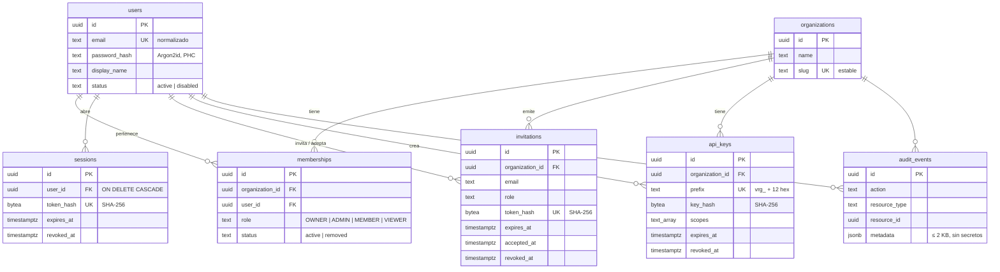
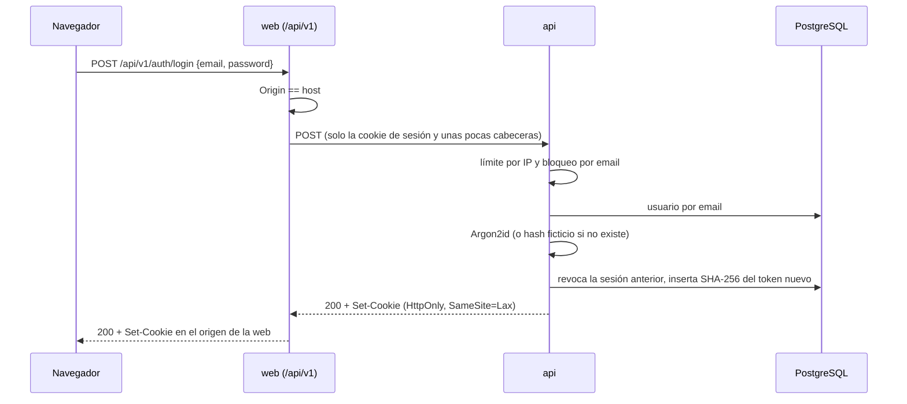
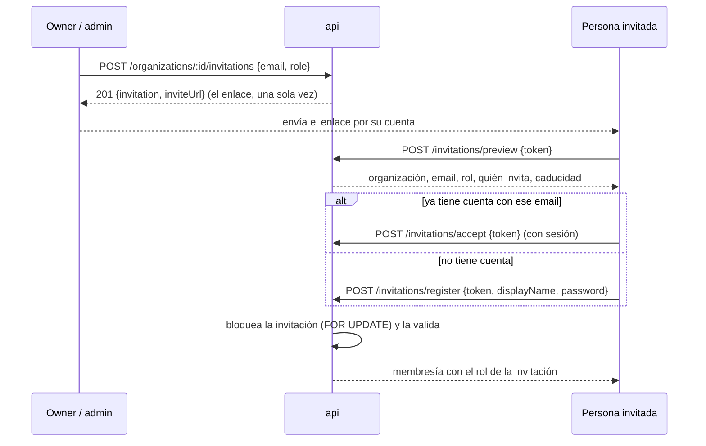

# Autenticación y organizaciones

Cómo funcionan hoy las cuentas, las sesiones, las organizaciones, las invitaciones y las API keys. Las decisiones y sus alternativas están en los ADR [0008](../adr/0008-sessions-in-postgresql.md), [0009](../adr/0009-local-credentials-first-oidc-later.md), [0010](../adr/0010-tenant-isolation-in-the-application.md) y [0011](../adr/0011-explicit-sql-and-uuidv7.md).

## Modelo de datos

- Los ids son UUIDv7 generados por PostgreSQL. Los emails se guardan sin espacios y en minúsculas, y la restricción `CHECK` lo garantiza.
- Nada se borra físicamente en esta fase. Las claves foráneas usan `ON DELETE RESTRICT`, salvo `sessions.user_id`, que es la única que borra en cascada.
- Una persona tiene como mucho una membresía activa por organización (índice único parcial). Las membresías dadas de baja quedan como historial.
- Una organización tiene como mucho una invitación abierta por email: invitar otra vez revoca la anterior.

## Roles

| Acción                                 | OWNER | ADMIN               | MEMBER | VIEWER |
| -------------------------------------- | ----- | ------------------- | ------ | ------ |
| Ver la organización y sus miembros     | ✓     | ✓                   | ✓      | ✓      |
| Salir de la organización               | ✓¹    | ✓                   | ✓      | ✓      |
| Renombrar la organización              | ✓     | ✓                   |        |        |
| Cambiar roles y dar de baja a miembros | ✓     | ✓, salvo a owners   |        |        |
| Nombrar owners                         | ✓     |                     |        |        |
| Invitar y cancelar invitaciones        | ✓     | ✓, salvo como owner |        |        |
| Crear, listar y revocar API keys       | ✓     | ✓                   |        |        |

¹ Siempre que quede otro owner.

Las reglas viven en [`membership-rules.ts`](../../apps/api/src/organizations/membership-rules.ts) y tienen tests unitarios. La web oculta las acciones que la API rechazaría, pero quien decide es siempre la API.

**Nunca sin owner.** Antes de cambiar el rol de alguien o darle de baja, la API bloquea con `SELECT … FOR UPDATE` las filas de los owners de la organización, siempre en el mismo orden, y después la del miembro afectado. Si el cambio dejaría la organización sin owners, responde `409 LAST_OWNER`. Dos owners que se degradan entre sí al mismo tiempo se serializan: uno lo consigue y el otro recibe el 409.

## Sesiones

- La cookie se llama `verarag_session`, o `__Host-verarag_session` cuando es `Secure` (siempre en producción).
- Cada petición busca la sesión por el hash del token. Una sesión revocada, de un usuario desactivado o inexistente da `401 INVALID_SESSION`; una caducada, `401 SESSION_EXPIRED`.
- `POST /api/v1/auth/logout` revoca la sesión y borra la cookie, aunque la sesión ya no sirviera.
- Las rutas son privadas por defecto: el `AuthGuard` global exige sesión salvo en las marcadas con `@Public()`.

## Organizaciones y aislamiento

Al registrarse, una persona crea en la misma transacción su usuario, su primera organización y su membresía de OWNER. Si algo falla, no queda nada a medias. Después puede crear más organizaciones o unirse a otras por invitación.

`OrganizationAccessGuard` resuelve el acceso de cada ruta con `:organizationId`: membresía activa y rol suficiente, o `404 ORGANIZATION_NOT_FOUND` si no es miembro. Las consultas de los repositorios siempre filtran por la organización. Detalle y alternativas en el [ADR 0010](../adr/0010-tenant-isolation-in-the-application.md).

La web recuerda en la cookie `verarag_org` la organización elegida en el selector. Es solo una preferencia: la API vuelve a comprobar la membresía en cada petición.

## Invitaciones

- El token tiene 256 bits aleatorios y solo se guarda su SHA-256. Vence a los `INVITATION_TTL_HOURS` (7 días por defecto), sirve una sola vez y se puede cancelar.
- El token viaja siempre en el cuerpo de un POST, nunca en la ruta de la API, para que no quede en sus logs de acceso. La página `/invitations/[token]` de la web responde con `Referrer-Policy: no-referrer`, para que el enlace no se filtre en la cabecera `Referer`, y con `X-Robots-Tag: noindex`.
- Solo puede aceptarla quien tenga el email invitado (`403 INVITATION_EMAIL_MISMATCH`). Quien crea su cuenta desde la invitación entra en esa organización y no recibe una propia.
- Un enlace desconocido o mal formado da `404 INVITATION_NOT_FOUND`. Uno vencido, usado o cancelado da `410` con el motivo.
- Todavía no se envían emails: quien invita copia el enlace y lo hace llegar.

## API keys

- Tienen la forma `vrg_<12 hex>_<43 base64url>`. El prefijo `vrg_…` es público y sirve para distinguirlas; la key completa se muestra una vez y solo se guarda su SHA-256.
- Pertenecen a la organización, no a quien las creó, así que siguen funcionando si esa persona se va.
- Se envían como `Authorization: Bearer <key>`, directamente a la API o a través de la web. Solo funcionan en rutas marcadas con `@ApiKeyScopes(...)`, y en cualquier otra reciben `403 INSUFFICIENT_SCOPE`. Scopes:

  | Scope               | Permite                               |
  | ------------------- | ------------------------------------- |
  | `system:read`       | `GET /api/v1/system/status`           |
  | `collections:read`  | Listar y leer colecciones             |
  | `collections:write` | Crear, renombrar y borrar colecciones |
  | `documents:read`    | Listar, leer y descargar documentos   |
  | `documents:write`   | Subir y borrar documentos             |

- Una key solo actúa en **su** organización: en las rutas de otra recibe el mismo `404` que un no miembro. Los scopes ocupan el lugar del rol, y lo que hace una key queda atribuido a ella (`created_by_api_key_id`, `actor_api_key_id` en la auditoría).
- Las keys existentes nunca reciben scopes nuevos: cuando aparece un scope, hay que crear una key que lo pida.
- Una key desconocida, mal formada o alterada da `401 INVALID_API_KEY`. Solo quien tiene la key real llega a saber si fue revocada (`API_KEY_REVOKED`) o venció (`API_KEY_EXPIRED`).
- `last_used_at` se actualiza como mucho cada 5 minutos.

## Límites de tasa

| Endpoint                                     | Límite por IP                                     |
| -------------------------------------------- | ------------------------------------------------- |
| Cualquiera (salvo health, métricas y estado) | 120 por minuto                                    |
| `POST /api/v1/auth/register`                 | 5 cada 10 minutos                                 |
| `POST /api/v1/auth/login`                    | 10 por minuto, y 5 fallos por email en 15 minutos |
| `POST /api/v1/invitations/preview`           | 20 por minuto                                     |
| `POST /api/v1/invitations/accept`            | 10 por minuto                                     |
| `POST /api/v1/invitations/register`          | 5 cada 10 minutos                                 |

Los contadores viven en la memoria de la API ([ADR 0008](../adr/0008-sessions-in-postgresql.md)).

## Auditoría

`audit_events` guarda una fila por acción sensible, en la misma transacción que la acción: `USER_REGISTERED`, `USER_LOGGED_IN`, `USER_LOGGED_OUT`, `ORGANIZATION_CREATED`, `ORGANIZATION_UPDATED`, `MEMBER_ROLE_CHANGED`, `MEMBER_REMOVED`, `MEMBER_INVITED`, `INVITATION_ACCEPTED`, `INVITATION_REVOKED`, `API_KEY_CREATED` y `API_KEY_REVOKED`. Cada fila lleva el actor, la organización, el recurso y metadatos pequeños (un rol, un prefijo, el request id). Nunca contraseñas, tokens ni keys. Todavía no hay una pantalla para consultarla.

## Endpoints

| Método y ruta                                                | Acceso                    |
| ------------------------------------------------------------ | ------------------------- |
| `POST /api/v1/auth/register`                                 | público                   |
| `POST /api/v1/auth/login`                                    | público                   |
| `POST /api/v1/auth/logout`                                   | público                   |
| `GET /api/v1/auth/me`                                        | sesión                    |
| `GET, POST /api/v1/organizations`                            | sesión                    |
| `GET /api/v1/organizations/:id`                              | miembro                   |
| `PATCH /api/v1/organizations/:id`                            | OWNER, ADMIN              |
| `GET /api/v1/organizations/:id/members`                      | miembro                   |
| `PATCH /api/v1/organizations/:id/members/:membershipId`      | OWNER, ADMIN              |
| `DELETE /api/v1/organizations/:id/members/:membershipId`     | OWNER, ADMIN, o uno mismo |
| `GET, POST /api/v1/organizations/:id/invitations`            | OWNER, ADMIN              |
| `DELETE /api/v1/organizations/:id/invitations/:invitationId` | OWNER, ADMIN              |
| `POST /api/v1/invitations/preview`                           | público                   |
| `POST /api/v1/invitations/accept`                            | sesión                    |
| `POST /api/v1/invitations/register`                          | público                   |
| `GET, POST /api/v1/organizations/:id/api-keys`               | OWNER, ADMIN              |
| `DELETE /api/v1/organizations/:id/api-keys/:apiKeyId`        | OWNER, ADMIN              |
| `GET /api/v1/system/status`                                  | sesión o `system:read`    |

Las rutas de colecciones y documentos están en [documents.md](documents.md).

Los cuerpos y las respuestas están en el documento OpenAPI ([api.md](api.md)).

## Lo que todavía no hay

- Verificación de email, recuperación de contraseña, cambio de email y MFA.
- Envío de invitaciones por email.
- Inicio de sesión con OIDC ([ADR 0009](../adr/0009-local-credentials-first-oidc-later.md)).
- Una vista para revisar las sesiones abiertas y cerrarlas a distancia.
- Row Level Security como segunda barrera ([ADR 0010](../adr/0010-tenant-isolation-in-the-application.md)).
- Límites de tasa compartidos entre réplicas.
- Una pantalla para consultar la auditoría.
