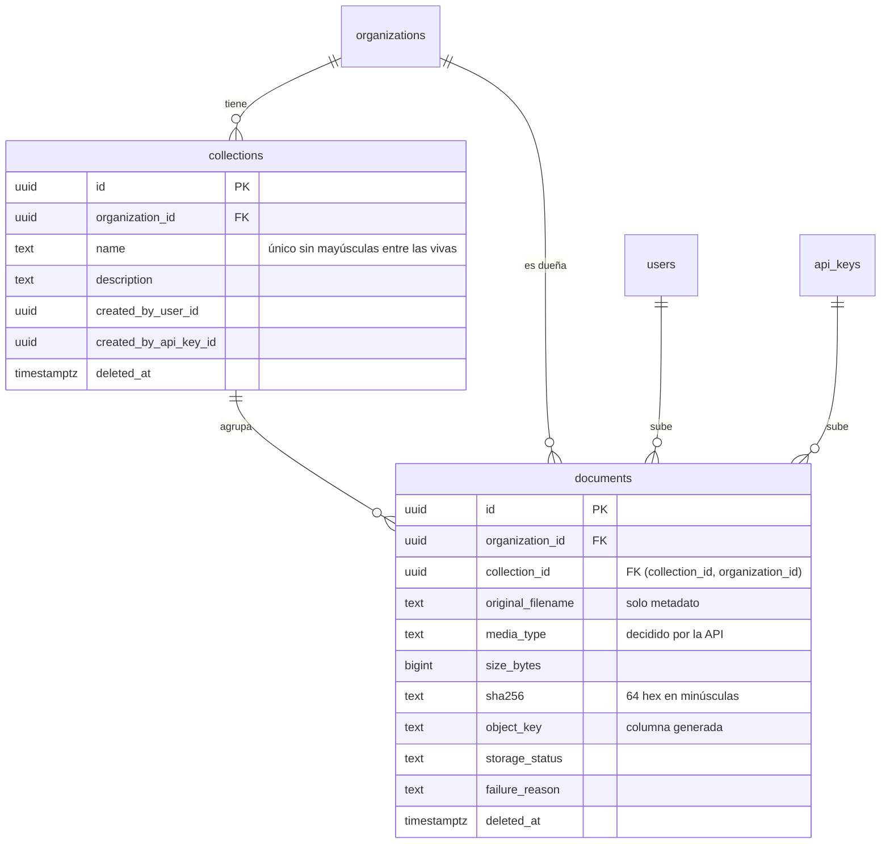

# Colecciones y documentos

Cómo se guardan, se suben, se descargan y se borran los documentos. Las decisiones de fondo están en el [ADR 0012](../adr/0012-streaming-uploads-and-storage-consistency.md) (streaming y consistencia) y el [ADR 0007](../adr/0007-s3-compatible-object-storage.md) (almacenamiento S3).

Los archivos subidos son **contenido no confiable**. Subir un documento no significa procesarlo ni considerarlo seguro: en esta fase no se extrae texto, no se ejecuta nada y nada de lo subido se renderiza en VeraRAG.

## Modelo



- **Colecciones.** Pertenecen a una sola organización. El nombre se normaliza (NFC, espacios de más fuera) y no puede repetirse dentro de la organización sin distinguir mayúsculas. Borrar es lógico (`deleted_at`) y solo se puede hacer si no quedan documentos: responde `409 COLLECTION_NOT_EMPTY`, y los documentos nunca se borran en cascada.
- **Documentos.** El contenido nunca entra en PostgreSQL. La clave foránea compuesta `(collection_id, organization_id)` hace que la base de datos rechace un documento en una colección de otra organización.
- **Quién lo hizo.** Una colección o un documento lo crea una persona o una API key, nunca ambas (`num_nonnulls(...) = 1`), y la interfaz muestra cuál.

## Claves de objeto

```
organizations/{organizationId}/documents/{documentId}/source
```

`object_key` es una columna **generada** a partir de los dos ids. Ningún dato del usuario forma parte de ella, así que el nombre de un archivo no puede producir path traversal ni colisiones. El nombre original se guarda aparte, limpio:

- solo el último componente de la ruta;
- NFC;
- sin caracteres de control ni de cambio de dirección (`‮` y compañía);
- sin espacios ni puntos al final;
- 255 caracteres como máximo, conservando la extensión.

El sufijo `/source` deja sitio para lo que la fase 3 derive del documento sin mezclarlo con el original.

## Estado del almacenamiento

`storage_status` describe **solo** el archivo guardado:

```
UPLOADING ──→ AVAILABLE ──→ DELETING ──→ DELETED
    └───────→ FAILED ─────────┘
```

| Estado      | Significado                                                                             | Se descarga |
| ----------- | --------------------------------------------------------------------------------------- | ----------- |
| `UPLOADING` | La subida está en curso, o se interrumpió por una caída de la API.                      | No          |
| `AVAILABLE` | El objeto está completo y verificado; tamaño y SHA-256 registrados.                     | Sí          |
| `FAILED`    | La subida no terminó: `too_large`, `type_not_allowed`, `storage_error` o `interrupted`. | No          |
| `DELETING`  | Se pidió el borrado y el objeto aún no se pudo eliminar.                                | No          |
| `DELETED`   | El objeto ya no existe. La fila queda como historial y no aparece en ninguna lista.     | No          |

No hay estados como `PROCESSING`, `INDEXED` o `EMBEDDED`, porque eso todavía no existe. La fase 3 tendrá su propio estado de ingesta, en otra columna: un documento puede estar `AVAILABLE` y no procesado, y un fallo de ingesta no debe confundirse con uno de almacenamiento.

## Subida

`POST /api/v1/organizations/:organizationId/collections/:collectionId/documents`, con `multipart/form-data` y exactamente una parte llamada `file`.

1. **Rechazos baratos, sin leer el cuerpo.** El usuario debe ser OWNER o ADMIN, o la API key debe tener `documents:write`. Además, la colección tiene que existir en la organización, y el `Content-Length` declarado no puede pasar del límite.
2. **Nombre y tipo.** La extensión decide el tipo. El tipo declarado por el cliente no puede contradecirlo, aunque `application/octet-stream` y vacío se aceptan.
3. **Primeros 8 KiB.** Se comprueba la firma del contenido. Todavía no se escribe nada.
4. **Fila `UPLOADING`.** Se inserta con un bloqueo compartido sobre la colección, que así no se puede borrar mientras tanto.
5. **Streaming a S3.** El contenido atraviesa el inspector, que cuenta bytes, corta en el primer byte que pasa del límite, calcula SHA-256 y valida, y llega a la subida multipart.
6. **Verificación.** Con `HEAD`, el tamaño guardado debe ser igual a los bytes enviados. La fila pasa a `AVAILABLE` y se audita.

Si algo falla después del paso 4, la fila queda `FAILED` y se borra lo subido, best effort. La respuesta es `201` con el documento, o un error del catálogo: `413 DOCUMENT_TOO_LARGE`, `415 DOCUMENT_TYPE_NOT_ALLOWED`, `400 INVALID_UPLOAD`, `503 DOCUMENT_UPLOAD_FAILED`.

### Cómo se evita cargar el archivo en memoria

| Salto           | Cómo                                                                                                                                                         |
| --------------- | ------------------------------------------------------------------------------------------------------------------------------------------------------------ |
| Navegador → web | `XMLHttpRequest` con `FormData`. El porcentaje viene de `upload.onprogress`; al 100 % se muestra "Saving…" hasta que la API confirma.                        |
| Web → API       | El route handler de `/api/v1` pasa `request.body` a `fetch` con `duplex: 'half'`. Next.js no lo lee antes porque `/api` no está en el matcher de `proxy.ts`. |
| API: multipart  | `busboy` lee el request directamente, sin body parser para multipart. Con backpressure, el request se lee al ritmo en que S3 consume.                        |
| API → S3        | `@aws-sdk/lib-storage`: partes de 5 MiB y dos en vuelo como máximo. Un fallo aborta la subida multipart sin dejar partes.                                    |

Pruebas:

- **Tests automáticos.**
  - En la API, el almacenamiento recibe más de 5 MiB de una subida mientras el cliente todavía no terminó de enviarla.
  - En la web, el servidor que hace de API recibe los primeros bytes antes de que el navegador cierre el stream, y el navegador recibe los primeros bytes de una descarga antes de que la API termine.
- **Experimento en Docker Compose.**
  - El pico de memoria de la API pasó de 152 a 186 MiB al pasar de un archivo de 24 MiB a uno de 200 MiB.
  - Con la API pausada a mitad de una subida de 200 MiB, la web aceptó unos 18 MiB más, en buffers de red, y luego bloqueó al cliente; su memoria subió 11 MiB.

### Tipos admitidos y cómo se detectan

| Tipo     | Extensiones        | Contenido exigido                                                                                                                                                |
| -------- | ------------------ | ---------------------------------------------------------------------------------------------------------------------------------------------------------------- |
| PDF      | `.pdf`             | `%PDF-` en el primer KiB.                                                                                                                                        |
| DOCX     | `.docx`            | Cabecera ZIP, y un directorio central (leído del final, sin descomprimir nada) que lista `[Content_Types].xml` y `word/document.xml`, sin `word/vbaProject.bin`. |
| Markdown | `.md`, `.markdown` | UTF-8 válido y sin bytes NUL.                                                                                                                                    |
| Texto    | `.txt`             | UTF-8 válido y sin bytes NUL.                                                                                                                                    |
| HTML     | `.html`, `.htm`    | UTF-8 válido y sin bytes NUL. Se guarda y se descarga, nunca se muestra.                                                                                         |

Límites de la detección, conocidos y aceptados en esta fase:

- **Firmas.** Una firma correcta no prueba que el archivo esté sano: un PDF con JavaScript o malformado pasa la comprobación. No hay antivirus ni análisis profundo.
- **DOCX.**
  - Un ZIP con las dos entradas obligatorias pasa aunque su contenido no sea un documento Word válido.
  - Se rechazan los DOCX cuyo directorio central no cabe en los últimos 256 KiB, y los ZIP64.
- **Texto.**
  - Markdown, texto y HTML no se distinguen por contenido: decide la extensión.
  - Los archivos en UTF-16 o Latin-1 se rechazan; hay que convertirlos a UTF-8.

### Tamaño máximo

`DOCUMENT_MAX_SIZE_BYTES`, 25 MiB por defecto. Alcanza para la mayoría de manuales y contratos, y un archivo equivocado falla rápido.

Se aplica **mientras llega el archivo**: la subida se corta en el primer byte de más, no al final. Si el cliente declara un tamaño mayor, se rechaza sin leer el cuerpo. La web consulta el límite y los tipos en `GET /api/v1/documents/upload-policy` para avisar antes de enviar, y la API vuelve a comprobarlo.

Cuando una subida se rechaza a mitad de camino, la API responde enseguida y descarta, como mucho, 4 MiB o 5 segundos del resto antes de cerrar la conexión. Así el cliente recibe el error y no un reset, y una subida enorme no se lee entera.

### Checksum

SHA-256 del contenido, calculado durante el streaming y guardado como **64 caracteres hexadecimales en minúsculas**: el mismo formato que `sha256sum` y `shasum -a 256`, que es como cualquiera lo comparará. La versión binaria (`bytea`) ahorraría 32 bytes por documento, que no compensan.

Servirá en las fases siguientes para detectar cambios, sincronizar fuentes de forma incremental, comprobar integridad y evitar reprocesar contenido idéntico. **No se deduplica**: dos documentos con el mismo SHA-256 pueden convivir si alguien los sube.

## Descarga

`GET /api/v1/organizations/:organizationId/documents/:documentId/content`, para cualquier miembro o una API key con `documents:read`.

- Solo documentos `AVAILABLE`. Los demás estados responden `409 DOCUMENT_NOT_AVAILABLE`; los borrados, `404`.
- El objeto se lee de S3 en streaming y se escribe en la respuesta. Si el tamaño guardado no coincide con el registrado, la API se niega a enviarlo.
- Cabeceras:
  - `Content-Type` con `charset=utf-8` para los tipos de texto;
  - `Content-Length`;
  - `Content-Disposition: attachment`, con el nombre escapado y codificado según RFC 8187, para que no admita inyección de cabeceras;
  - `X-Content-Type-Options: nosniff`;
  - `Content-Security-Policy: default-src 'none'; sandbox`;
  - `Cache-Control: no-store`.
- **Nunca `inline`.** Un HTML subido se guarda en el disco del usuario y, si alguien lo abre desde la web, corre en un sandbox sin permisos. La web aplica el mismo CSP a todo lo que sale por `/api`, porque Next.js pisa las cabeceras que pone un route handler.
- Si S3 no responde: `503 STORAGE_UNAVAILABLE`.

## Borrado

`DELETE /api/v1/organizations/:organizationId/documents/:documentId`, para OWNER, ADMIN o una API key con `documents:write`.

1. La fila pasa a `DELETING` y el borrado queda en la auditoría. Desde ese momento no se descarga.
2. Se borra el objeto. Si no existía, también cuenta como hecho.
3. La fila pasa a `DELETED` con `deleted_at`.

Si S3 falla en el paso 2, la respuesta es `503 DOCUMENT_DELETE_FAILED`. El documento queda `DELETING`, visible en la lista, y repetir el borrado retoma el paso 2. Borrar un documento ya borrado responde `204`.

## Consistencia entre PostgreSQL y S3

No hay transacción entre los dos, y el diseño no lo finge. La fila se escribe antes que el objeto, los estados describen lo que pudo quedar a medias y todas las transiciones son compare-and-set. La tabla de situaciones y lo que podrá hacer una tarea de reconciliación futura están en el [ADR 0012](../adr/0012-streaming-uploads-and-storage-consistency.md).

## Permisos

| Acción                                | OWNER, ADMIN | MEMBER, VIEWER | API key             |
| ------------------------------------- | ------------ | -------------- | ------------------- |
| Ver colecciones                       | ✓            | ✓              | `collections:read`  |
| Crear, renombrar y borrar colecciones | ✓            |                | `collections:write` |
| Listar, ver y descargar documentos    | ✓            | ✓              | `documents:read`    |
| Subir y borrar documentos             | ✓            |                | `documents:write`   |

Una API key solo actúa en su organización, y las keys creadas antes de esta fase conservan sus scopes. Los permisos por colección o por documento, y un rol de gestor de conocimiento, llegan en la **fase 9**. Hasta entonces, todo miembro ve todos los documentos de su organización.

Una organización nunca puede ver ni tocar los documentos de otra:

- su ruta responde `404 ORGANIZATION_NOT_FOUND`;
- los ids de otra organización bajo la ruta propia responden `404 DOCUMENT_NOT_FOUND` o `404 COLLECTION_NOT_FOUND`;
- la base de datos rechaza un documento en una colección ajena.

## Auditoría, métricas y logs

- **Auditoría.**
  - Se registran `COLLECTION_CREATED`, `COLLECTION_UPDATED`, `COLLECTION_DELETED`, `DOCUMENT_UPLOADED` (con tipo, tamaño y colección, sin el nombre del archivo) y `DOCUMENT_DELETED`.
  - Las acciones hechas con una API key se atribuyen a la key (`actor_api_key_id`).
  - **Las descargas no se auditan en esta fase.** Son lecturas, y registrar cada una haría crecer la auditoría con cada visita. El acceso de lectura se auditará junto con las consultas en la fase 9. Mientras tanto, `verarag_document_downloads_total` las cuenta.
- **Métricas.**
  - `verarag_collections`, `verarag_documents{status}`, `verarag_document_uploads_total{result}`, `verarag_document_upload_bytes_total`, `verarag_document_downloads_total{result}`, `verarag_document_deletes_total{result}` y `verarag_storage_operation_duration_seconds{operation,outcome}`.
  - Ninguna lleva ids, nombres ni claves.
- **Trazas.** Spans `s3 put`, `s3 get`, `s3 head` y `s3 delete`, hijos de la petición HTTP.
- **Logs.** Registran el id del documento, la colección, el tipo y el tamaño. Nunca el contenido, el cuerpo multipart ni los mensajes del SDK de S3, que pueden incluir endpoints.

## Lo que todavía no hay

- Extracción de texto, chunking, embeddings y búsqueda: fases 3 a 5.
- Antivirus, OCR y conversión de formatos.
- Permisos por colección y documento: fase 9.
- Una tarea que reconcilie documentos atascados en `UPLOADING` o `DELETING`.
- Subidas múltiples o reanudables, y URLs prefirmadas.
