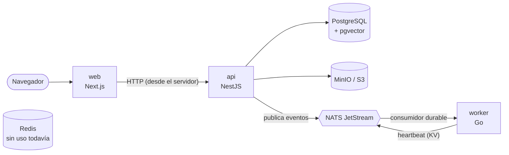
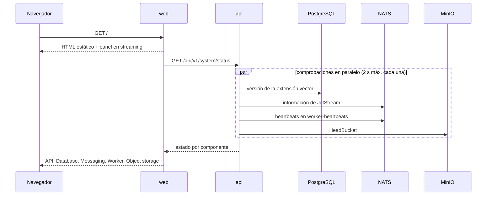
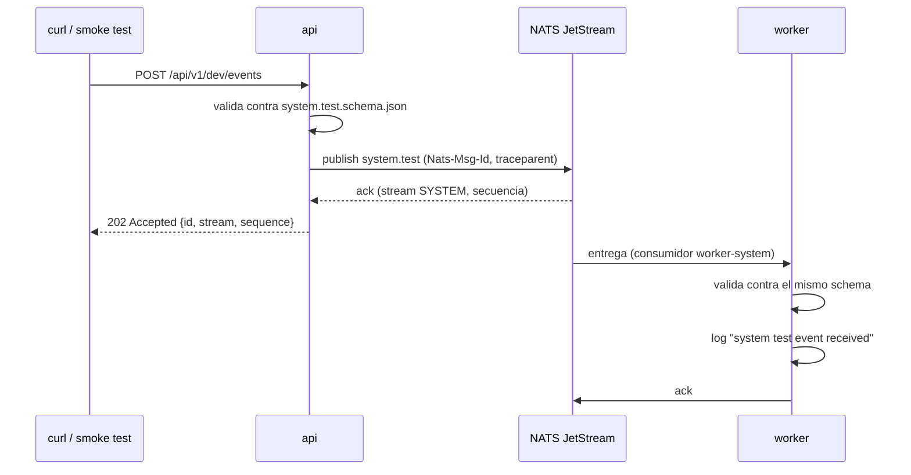

# Arquitectura

Este documento describe lo que existe hoy y hacia dónde va. Lo que todavía no está implementado aparece marcado como _planificado_.

## Componentes

| Componente     | Tecnología               | Hoy                                                                                     | Planificado                                                                          |
| -------------- | ------------------------ | --------------------------------------------------------------------------------------- | ------------------------------------------------------------------------------------ |
| `web`          | Next.js 16, React 19     | Página que explica el proyecto y muestra el estado de cada componente.                  | Login, gestión de documentos y colecciones, chat con fuentes, administración.        |
| `api`          | NestJS 12, Node.js 24    | Health, readiness, métricas, estado del sistema y un endpoint de desarrollo de eventos. | Autenticación, organizaciones, permisos, documentos, conversaciones, RAG, auditoría. |
| `worker`       | Go 1.27                  | Consume `system.test`, publica su heartbeat, expone health y métricas.                  | Extracción, normalización, chunking, embeddings, indexación y reindexación.          |
| PostgreSQL     | PostgreSQL 18 + pgvector | Fuente de verdad. Solo tiene habilitada la extensión `vector`.                          | Organizaciones, usuarios, documentos, fragmentos y vectores.                         |
| NATS JetStream | NATS 2.15                | Stream `SYSTEM` y bucket `worker-heartbeats`.                                           | Stream `DOCUMENTS` con los eventos de ingesta.                                       |
| Object storage | MinIO (local), API de S3 | La API comprueba que el bucket existe.                                                  | Documentos originales.                                                               |
| Redis          | Redis 8                  | Se levanta con Docker Compose, pero ningún servicio lo usa.                             | Caché, rate limiting compartido, sesiones y locks.                                   |

La web nunca habla con la base de datos ni con NATS: solo llama a la API, y lo hace desde su servidor. La API y el worker no se llaman entre sí: solo se comunican por NATS, con los contratos de [`packages/contracts`](../../packages/contracts).

## Flujos actuales

### Estado del sistema

La API guarda el resultado durante 2 segundos, así que varias pestañas abiertas no multiplican las consultas a la infraestructura. El navegador refresca el panel cada 10 segundos.

El worker se considera sano si hay al menos una entrada en el bucket `worker-heartbeats`. Cada instancia escribe la suya cada 10 segundos mientras puede consumir eventos, las entradas caducan a los 30 segundos y el worker borra la suya al apagarse.

### Evento de prueba

El endpoint solo existe con `DEV_ENDPOINTS_ENABLED=true`. Sirve para comprobar que la arquitectura funciona de punta a punta y no forma parte del producto.

## Quién es dueño de qué

- **Esquema de la base de datos:** la API. Las migraciones están en `apps/api/db/migrations` y se aplican con dbmate antes de que arranque la API.
- **Streams de NATS:** la API los crea o actualiza al arrancar. El worker espera a que existan.
- **Consumidores durables:** cada worker define el suyo.
- **Bucket de heartbeats:** el worker lo crea; la API solo lo lee.
- **Contratos:** `packages/contracts`, compartido por ambos lenguajes.

## Endpoints operativos

| Servicio | Endpoint                    | Uso                                                |
| -------- | --------------------------- | -------------------------------------------------- |
| web      | `GET /healthz`              | Liveness. No comprueba la API.                     |
| api      | `GET /healthz`              | Liveness. No comprueba dependencias.               |
| api      | `GET /readyz`               | Readiness: PostgreSQL y NATS responden. 503 si no. |
| api      | `GET /metrics`              | Métricas de Prometheus.                            |
| api      | `GET /api/v1/system/status` | Estado detallado para la interfaz.                 |
| worker   | `GET /healthz`              | Liveness (puerto 8081, solo en la red interna).    |
| worker   | `GET /readyz`               | Conectado a NATS y consumiendo eventos.            |
| worker   | `GET /metrics`              | Métricas de Prometheus.                            |

`/metrics` y `/api/v1/system/status` no deberían exponerse públicamente en un despliegue real; hoy no tienen autenticación porque todavía no existe.

## Lo que todavía no está

- **Autenticación y autorización.** Todos los endpoints son públicos. Llegan en la fase 1.
- **Aislamiento entre organizaciones.** No hay datos de clientes todavía; el modelo de tenants se define en la fase 1 y se completa en la fase 9.
- **Outbox.** Cuando la API escriba en la base de datos y publique eventos en la misma operación, hará falta para no perder eventos (fase 3).
- **NATS en producción.** El entorno local no usa autenticación, TLS ni réplicas.
- **Redis.** Está provisionado pero ningún servicio lo usa.

## Hacia dónde va (planificado)

**Ingesta:** la web sube un documento → la API lo guarda en el almacenamiento de objetos y registra sus metadatos → publica `document.ingestion.requested` → el worker extrae el texto, lo divide en fragmentos, calcula embeddings y los guarda en PostgreSQL → publica `document.ingestion.completed` o `document.ingestion.failed` → la API actualiza el estado del documento.

**Consulta:** la persona pregunta → la API recupera fragmentos con búsqueda vectorial y léxica filtrada por permisos → los reordena y descarta evidencia insuficiente → llama al LLM → devuelve la respuesta con sus fuentes y registra la consulta para auditoría y evaluación.

El orden y el alcance de cada paso están en el [roadmap](../roadmap.md).
